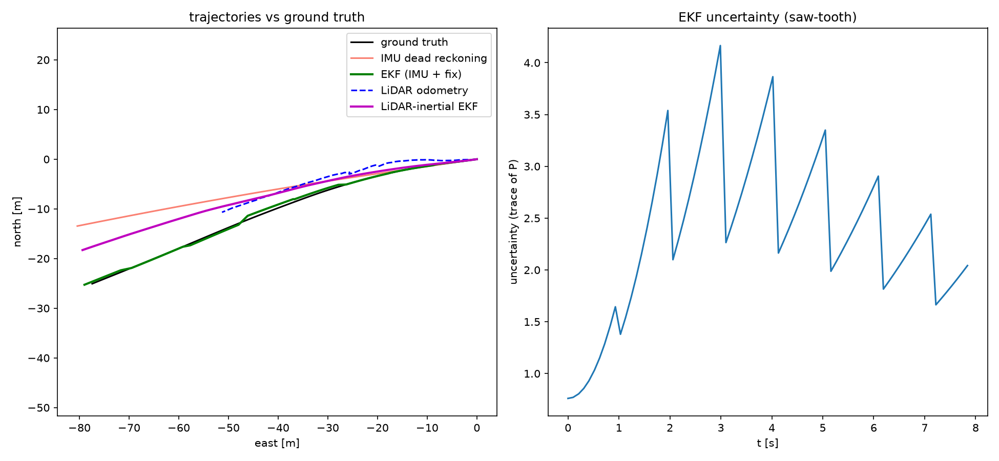
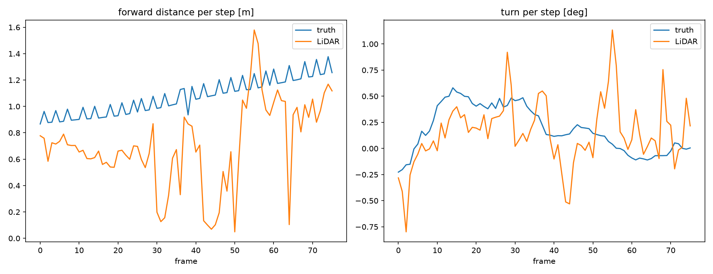

# LiDAR-Inertial Pose Estimation on KITTI

A 2D **Extended Kalman Filter** that fuses a vehicle's **IMU** and **LiDAR** into a pose
estimate more accurate than either sensor alone — built from scratch in NumPy/SciPy
(no filtering or scan-registration libraries), validated on the KITTI dataset, and
wrapped in a live **ROS 2** system with RViz visualization.

> **Headline result:** fusing IMU + LiDAR reduced position error to **3.77 m**, versus
> **5.62 m** for the IMU alone and **17.93 m** for LiDAR alone, on an ~8 s KITTI drive.



---

## Results

Position RMSE against RTK-GPS ground truth (KITTI `2011_09_26_drive_0002`):

| Method | Position RMSE | Notes |
|---|---:|---|
| LiDAR only (ICP odometry) | 17.93 m | fails on a straight road (see *aperture problem* below) |
| IMU only (dead reckoning) | 5.62 m | drifts; error dominated by gyro-bias heading drift |
| **LiDAR + IMU (this EKF)** | **3.77 m** | **better than either single sensor** |
| IMU + GPS (absolute reference) | 0.71 m | upper bound, shown for context — needs an absolute fix |

The fused estimate (magenta) tracks the ground truth far better than the drifting
IMU-only estimate, while LiDAR-only odometry diverges.

---

## Why fusion works here

The most interesting result is *why* the two sensors complement each other. They fail
in **opposite** places:

- The **IMU** measures forward motion directly and accurately, but its gyro has a small
  bias, so **heading drifts** — error grows roughly linearly in time.
- The **LiDAR**, on this straight, feature-poor road, **cannot measure forward distance**:
  sliding a scan along a straight wall looks identical, so Iterative Closest Point (ICP)
  is unconstrained along the direction of travel (the *aperture problem*). Its heading
  estimate, however, is noisy but unbiased.



So the fusion lets the **IMU carry the forward motion** (its strength) and uses the
**LiDAR to correct heading** (the IMU's weakness). The Kalman filter does this
automatically once each sensor's noise is modeled honestly.

---

## How it works

**State** `[x, y, θ, v]` — planar position, heading, forward speed.

**Predict (IMU, ~100 steps/run):** a unicycle motion model driven by the IMU's forward
acceleration and yaw rate advances the state; the error covariance `P` is propagated with
the analytic Jacobian `F` and process noise `Q`.

**Correct (measurement):** a Kalman update folds in a measurement, shrinking `P`:

```
surprise = z − H·state
K        = P·Hᵀ·(H·P·Hᵀ + R)⁻¹
state    = state + K·surprise
P        = (I − K·H)·P
```

Two measurement sources are implemented:
- an **absolute position fix** (a GPS-style reference) — the 0.71 m upper bound, and
- the **LiDAR heading** from scan matching — the honest LiDAR-inertial fusion (3.77 m).

**LiDAR odometry (ICP):** consecutive scans are cleaned (ground removed, down-sampled,
projected top-down) and aligned with a from-scratch 2D ICP (KD-tree nearest-neighbour
matching + SVD rigid fit). The alignment transform is the inter-scan motion.

---

## ROS 2 system

The estimator core is ROS-independent; the ROS nodes are thin wrappers around it.

```
 sensor_replay ──/imu/data (sensor_msgs/Imu)──────────┐
      │                                               ├──> ekf_node ──/ekf/odom──> RViz
      └────────/ground_truth/odom (nav_msgs/Odometry)─┘      + TF (odom → base_link_ekf)
```

| Node | Subscribes | Publishes |
|---|---|---|
| `sensor_replay` | — | `/imu/data`, `/ground_truth/odom` |
| `ekf_node` | `/imu/data` | `/ekf/odom`, TF |


---

## Repository layout

```
.
├── pose_estimate.py                     # full estimator (data, dead reckoning, EKF, ICP, fusion)
├── images/                              # result plots
└── src/lidar_inertial_ekf/              # ROS 2 package (ament_python)
    └── lidar_inertial_ekf/
        ├── pose_estimate.py             # the ROS-independent core, reused by the nodes
        ├── sensor_replay_node.py
        └── ekf_node.py
```

---

## Running it

**Offline (no ROS needed)** — reproduces the numbers and plots:

```bash
pip install numpy scipy matplotlib
python3 pose_estimate.py
```

**ROS 2** (tested on ROS 2 Lyrical / Ubuntu 26.04):

```bash
cd ~/ros2_ws            # your workspace
colcon build --symlink-install
source install/setup.bash

ros2 run lidar_inertial_ekf ekf_node        # terminal 1
ros2 run lidar_inertial_ekf sensor_replay   # terminal 2
rviz2                                        # add /ground_truth/odom and /ekf/odom, fixed frame "odom"
```

---

## Key decisions & honest limitations

- **Built from scratch.** The EKF (predict/update, Jacobians, covariance) and the ICP
  (matching + SVD fit) are implemented directly, not called from a library — the goal was
  to understand and be able to explain every step.
- **Planar (2D) model.** The vehicle is treated as moving on a plane; small roll/pitch and
  elevation are ignored. A reasonable approximation for this drive, stated as a deliberate
  choice.
- **Relative vs absolute.** LiDAR odometry is a *relative* measurement, so the LiDAR-inertial
  estimate still drifts slowly (no absolute anchor). The GPS row shows what an absolute
  reference — or loop closure / a map — would add. This is the expected ceiling for
  LiDAR-inertial odometry without one.
- **Next steps:** estimate the gyro bias as an explicit filter state; run on a curvier drive
  where LiDAR odometry is better constrained; add a live LiDAR-odometry node to the ROS graph.

---

## Built with

Python · NumPy · SciPy · Matplotlib · ROS 2 (rclpy) · RViz · the KITTI dataset.
